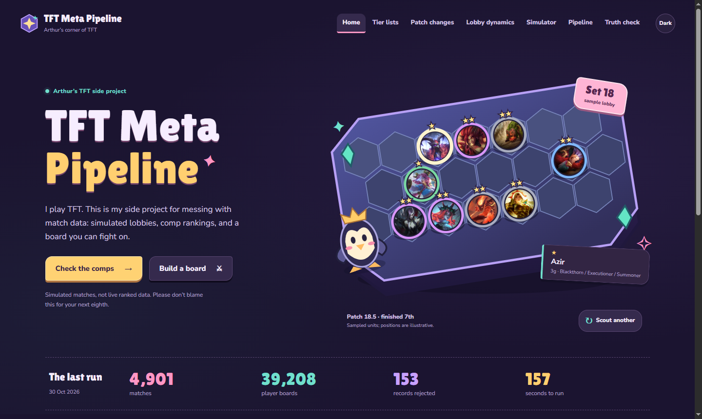

# TFT Meta Pipeline

I play Teamfight Tactics. This is my side project for messing with match data: simulated lobbies, comp rankings, and a board you can fight on.

Python generates eight-player lobbies, an ETL loads the records into MySQL, and a React site shows the results. The simulator keeps its hidden strength values separate, so I can check whether the rankings recover them.

[Explore the project](https://arthurgaspar.github.io/tft-meta-pipeline/) · [Read the pipeline](functions/validate/handler.py) · [Inspect the tests](tests/test_etl.py)

**By [Arthur](https://github.com/ArthurGaspar)** · Python / MySQL / React / TypeScript / GitHub Actions



## What it does

- **Data quality at ingestion.** Reject malformed records before they reach SQL. Keep their source line and reason; isolate unreadable files through retries and a dead-letter queue.
- **Repeatable loading.** A transaction covers each staged file. A key/ETag log skips re-delivered files, while match IDs prevent duplicate inserts across files.
- **An explicit statistical method.** Small samples shrink toward average; low-volume entities stay unranked. Patch comparisons use a declared significance threshold.
- **A check independent of the ETL.** Hidden powers and original economy plans stay outside the pipeline. The evaluation report uses them to expose ranking errors and selection bias.

The infrastructure runs on **minicloud**, a local AWS-style emulator written for this repository. This is not an AWS deployment or a production-scale benchmark.

## Data path

```text
Simulated lobbies -> raw NDJSON -> Validate -> staged NDJSON -> Load -> MySQL
                                    |                           |
                                    +-> quarantine              +-> Aggregate (schedule)
                                                                      |
Failed invocations -> 2 retries -> dead-letter queue                   v
                                                             public JSON -> React
```

`infra/stack.yaml` declares buckets, functions, triggers, a queue, and a schedule. minicloud models S3 notification payloads, Lambda's `handler(event, context)` contract, warm environments, timeouts, logs, and a simulated clock. Functions run sequentially in one process. MariaDB locally, or MySQL in CI, provides the actual database.

The simulator generates Riot-shaped match records from checked-in Set 18 snapshots. It models economy plans, a shared champion pool, and abstract positioning. Patch snapshot differences move the hidden strength values; translating a stat change into strength is a modeling choice.

## Results and the limits of the result

The recorded run from **30 October 2026** processed **4,901 valid matches / 39,208 player boards** across five patch snapshots in **157 seconds**. It quarantined **153 records** and dead-lettered **one deliberately unreadable file**. Runtime depends on the machine; these are observations from that run.

| Rank correlation with hidden power | Range across patches |
| --- | --- |
| Champions | 0.60-0.76 |
| Items | 0.94-0.99 |
| Augments | 0.95-0.97 |

These are Spearman correlations **inside the simulation**, not evidence of predictive accuracy on real TFT matches. Champions are harder to rank because cost, teammates, economy, and competition for copies all affect placement.

**A weird result:** boards inferred as Fast 9 average about **2.77** placement, while all players actually assigned that plan average **4.52**. Players eliminated before level 9 disappear from the final-board category. The dashboard puts those views side by side instead of assigning economy plans a tier. The plan classifier agrees with the original plan on about **67%** of boards.

Patch detection is less convincing: of 61 changed entities across patch transitions, the pipeline flagged 11 shifts, six on entities whose modeled power changed; five of those moved in the expected direction. With roughly 1,000 matches per patch, many small changes remain undetected. The report shows the misses as well as the hits.

## Explore the interface

- **Home:** a scoutable sample lobby, the last run, and a look at what’s going on with Fast 9.
- **Tier lists:** per-patch rankings for comps, champions, items, augments, and trait breakpoints; champion item combinations pool all patches.
- **Patch changes / Lobby dynamics / Truth check:** changes detected, competition for units, inferred economy plans, and evaluation against hidden values.
- **Simulator:** a seeded TypeScript combat model on a hex board. Build a team, watch a fight, or run batches against sampled opponents. Missing ability values are estimated and labeled; this is not a replica of live TFT combat.

## Run it locally

Requires Python 3.11+, Node 22.12+, and MariaDB binaries (or an existing MySQL-compatible server).

```sh
python -m venv .venv
```

Activate with `.venv\Scripts\Activate.ps1` in PowerShell or `source .venv/bin/activate` on macOS/Linux, then:

```sh
pip install -r requirements.txt
python localdb.py start
python run.py
python -m pytest -q
```

`localdb.py` starts a private MariaDB instance in `.db/`, on port 3307. Set `MARIADB_BIN` to your installation's binary directory if needed. To use an existing server, skip that command and set `DB_HOST`, `DB_PORT`, `DB_USER`, `DB_PASSWORD`, and `DB_NAME` to a **dedicated project database**. Pipeline runs rebuild the project tables; the integration test does too.

```sh
cd web
npm ci
npm run check:sim
npm run build
npm run dev
```

Generate the data before opening the dashboard. `python run.py --matches 1000` makes a quicker run; the default generates 5,000 matches. To stop the private database, run `python localdb.py stop` from the repository root.

## Verification

Python tests cover the emulator's events, retries, timeouts and schedules; ingestion of malformed records; deduplication; patch mapping; simulated lobby mechanics; and the ranking/evaluation calculations. The database integration test is skipped when no database is reachable, so a green local run can exclude that check.

`npm run check:sim` checks combat rules, ability coverage, seeded replay, termination, and agreement with sampled lobby results. `npm run build` checks TypeScript and builds the site. GitHub Actions starts MySQL, runs the Python tests and pipeline, checks the combat simulator, and builds the site; pushes to `master` also deploy to GitHub Pages.

## Code map

| Location | Responsibility |
| --- | --- |
| [`simulator/`](simulator/) | Static snapshots, patch differences, lobby generation |
| [`minicloud/`](minicloud/) | Local storage, function execution, retries, scheduling, template validation |
| [`functions/`](functions/) | Validate, transform/load, aggregate |
| [`sql/schema.sql`](sql/schema.sql) | Normalized match tables and derived statistics |
| [`run.py`](run.py) | Orchestration, report export, independent evaluation |
| [`web/src/`](web/src/) | Dashboard and browser combat model |
| [`tests/`](tests/) | Python unit and integration checks |

## Boundaries

- **Synthetic matches:** a controlled experiment enables the answer key, but does not validate the model against real players. Boards are selected before round-by-round elimination; positioning is an abstract skill and formation.
- **Inferred labels:** a comp is the strongest active trait plus its most itemized unit. Economy plans inferred from final boards are imperfect and affected by survival.
- **Statistics:** sample shrinkage and a strict z threshold reduce noise; they do not establish causality or formally control multiple comparisons. Boards in a lobby are dependent observations.
- **Local infrastructure:** minicloud does not provide cloud isolation, concurrent workers, or distributed delivery guarantees. Its AWS cost report uses illustrative rates stored in the source, not live pricing or actual billing.
- **Stored game data:** the demo uses checked-in snapshots, not a live patch feed. `python -m simulator.static_data` refreshes snapshots; icons are externally hosted and may change. The combat model estimates missing ability values and omits between-round systems.
